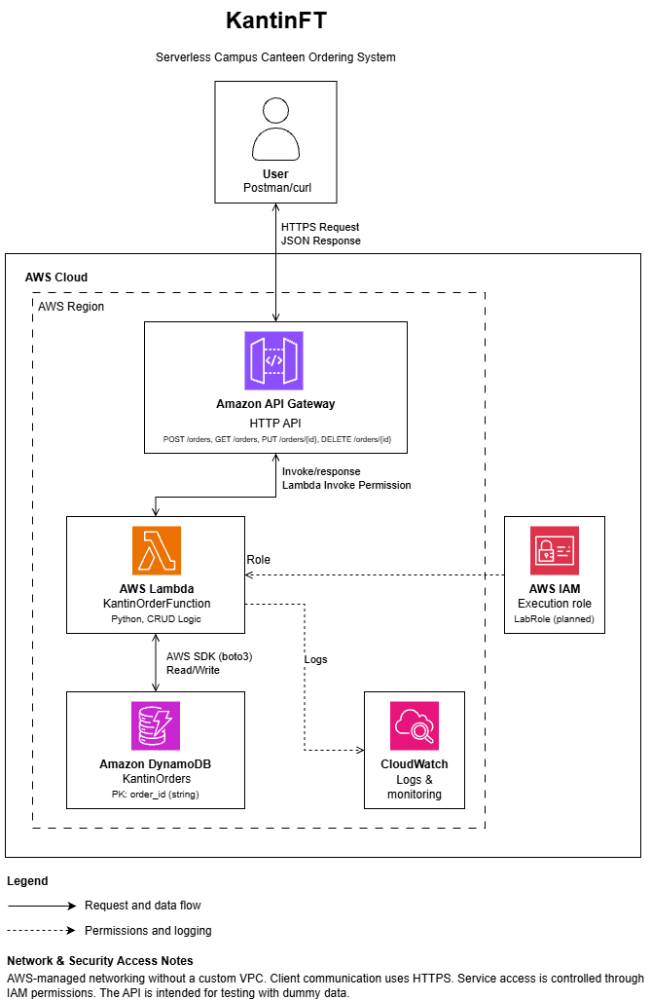

# KantinFT

**Serverless Campus Canteen Ordering System on AWS**

## Deskripsi Proyek

KantinFT merupakan sistem pemesanan makanan berbasis cloud yang dirancang untuk lingkungan Fakultas Teknik Universitas Gadjah Mada. Antrean pemesanan makanan pada jam istirahat dapat menyebabkan mahasiswa membutuhkan waktu lebih lama untuk mendapatkan makanan.

KantinFT memungkinkan pengguna melakukan pemesanan makanan sebelum waktu pengambilan serta membantu tenant mengelola data dan status pesanan. Pada tahap awal, sistem berfokus pada pengelolaan pesanan melalui operasi Create, Read, Update, dan Delete (CRUD).

Ruang lingkup proyek meliputi pembuatan pesanan, penampilan daftar pesanan, pembaruan data dan status pesanan, penghapusan pesanan, serta perhitungan total harga. Fitur autentikasi pengguna, pembayaran digital, katalog menu, dan antarmuka pengguna berada di luar ruang lingkup implementasi awal.

## Informasi Proyek

| Aspek                 | Keterangan                  |
| --------------------- | --------------------------- |
| Use Case              | Simple Orders               |
| Track                 | Track C: Serverless         |
| Bahasa Pemrograman    | Python                      |
| Database              | Amazon DynamoDB             |
| API                   | Amazon API Gateway HTTP API |
| Compute               | AWS Lambda                  |
| Lingkungan Deployment | AWS Learner Lab             |
| Pengujian API         | Postman / curl              |

## Ruang Lingkup

- Membuat pesanan makanan.
- Menampilkan daftar pesanan.
- Memperbarui data dan status pesanan.
- Menghapus pesanan.
- Menghitung total harga secara otomatis.
- Menyimpan data pesanan pada DynamoDB.
- Melakukan validasi input dan penanganan kesalahan API.

## Arsitektur Sistem

KantinFT menggunakan arsitektur serverless yang terdiri dari beberapa layanan AWS berikut:

| Layanan AWS        | Fungsi                                                                             |
| ------------------ | ---------------------------------------------------------------------------------- |
| Amazon API Gateway | Menerima HTTP request dari pengguna dan meneruskannya ke Lambda.                   |
| AWS Lambda         | Menjalankan logika bisnis dan operasi CRUD menggunakan Python.                     |
| Amazon DynamoDB    | Menyimpan dan mengelola data pesanan makanan.                                      |
| AWS IAM            | Mengatur izin akses antarservice melalui execution role dan invocation permission. |
| Amazon CloudWatch  | Mencatat log eksekusi serta mendukung monitoring dan debugging.                    |

Pengguna mengirimkan HTTP request melalui Postman atau curl menggunakan HTTPS. API Gateway meneruskan request kepada Lambda untuk diproses sesuai operasi yang diminta. Lambda kemudian berinteraksi dengan DynamoDB menggunakan AWS SDK (boto3). Hasil pemrosesan dikembalikan kepada pengguna dalam format JSON.

Sistem menggunakan jaringan yang dikelola oleh AWS tanpa konfigurasi custom VPC.

## Model Data

- **Entitas:** Order
- **Nama tabel:** KantinOrders
- **Partition key:** order_id (String)
- **Capacity mode:** On-demand

| Atribut       | Tipe Data | Keterangan                 |
| ------------- | --------- | -------------------------- |
| order_id      | String    | ID unik pesanan            |
| customer_name | String    | Nama pemesan               |
| tenant_name   | String    | Nama tenant kantin         |
| food_name     | String    | Nama makanan yang dipesan  |
| quantity      | Number    | Jumlah makanan             |
| unit_price    | Number    | Harga satuan dalam rupiah  |
| total_price   | Number    | Total harga pesanan        |
| pickup_time   | String    | Jadwal pengambilan pesanan |
| status        | String    | Status pesanan             |
| created_at    | String    | Waktu pembuatan pesanan    |
| updated_at    | String    | Waktu pembaruan pesanan    |

## API Endpoints

| Method | Endpoint     | Operasi | Keterangan                  |
| ------ | ------------ | ------- | --------------------------- |
| POST   | /orders      | Create  | Membuat pesanan baru        |
| GET    | /orders      | Read    | Menampilkan seluruh pesanan |
| PUT    | /orders/{id} | Update  | Memperbarui data pesanan    |
| DELETE | /orders/{id} | Delete  | Menghapus pesanan           |

## Aturan Bisnis

- ID pesanan dihasilkan secara otomatis menggunakan UUID.
- Setiap pesanan terdiri dari satu jenis makanan dari satu tenant.
- Jumlah makanan dan harga satuan harus berupa bilangan bulat positif.
- Total harga dihitung secara otomatis berdasarkan jumlah makanan dan harga satuan.
- Status awal pesanan adalah PENDING.
- Status pesanan dapat diperbarui menjadi PROCESSING, READY, atau COMPLETED.
- Waktu pengambilan menggunakan format ISO 8601.
- Operasi pembaruan dan penghapusan hanya dapat dilakukan terhadap pesanan yang tersedia.

Pada prototipe ini, harga satuan masih dimasukkan melalui request karena pengelolaan katalog menu berada di luar ruang lingkup proyek.

## Struktur Repository

| Path             | Keterangan                                            |
| ---------------- | ----------------------------------------------------- |
| src/             | Source code AWS Lambda                                |
| docs/            | Diagram arsitektur, design brief, dan deployment plan |
| tests/           | JSON test events untuk pengujian Lambda               |
| evidence/        | Dokumentasi konfigurasi dan hasil pengujian AWS       |
| requirements.txt | Daftar dependensi Python                              |
| README.md        | Dokumentasi utama proyek                              |

## Deployment

Deployment dilakukan menggunakan AWS Learner Lab. Tahapan deployment meliputi pembuatan tabel DynamoDB, konfigurasi Lambda, verifikasi izin IAM, integrasi API Gateway, dan pengujian konektivitas antarservice.

Panduan deployment secara lengkap tersedia pada [Deployment Plan](docs/deployment-plan.md).

## Dokumentasi

- [Architecture Diagram](docs/KantinFT.drawio.png)
- [Design Brief](docs/design-brief.pdf)
- [Deployment Plan](docs/deployment-plan.md)

## Keamanan dan Efisiensi Biaya

- Tidak menyimpan AWS credentials pada repository.
- Menggunakan data dummy selama pengujian.
- Menggunakan IAM role yang tersedia dan diizinkan oleh AWS Learner Lab.
- Memantau penggunaan kredit AWS secara berkala.
- Menghindari pembuatan resource cloud yang tidak diperlukan.
